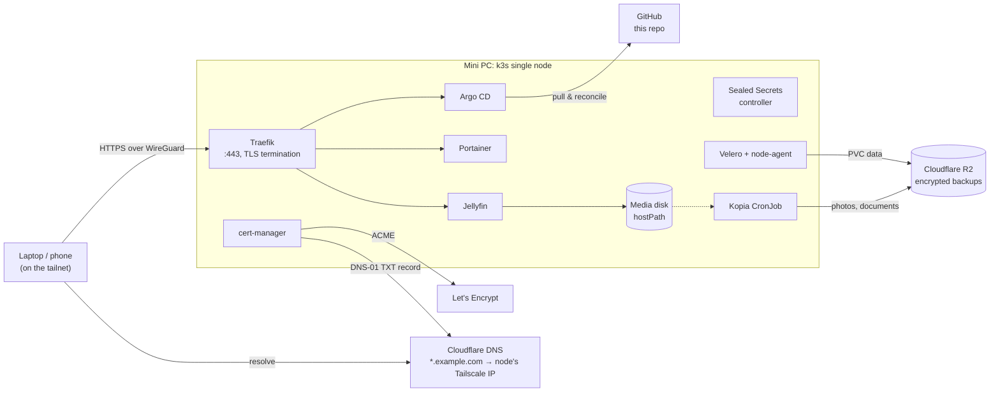

# HomeCluster

A single-node Kubernetes homelab, run entirely through GitOps. One small PC (an HP ProDesk mini) serves media, a container dashboard and its own GitOps controller. Everything is reachable only over a private Tailscale network, but still gets real, browser-trusted TLS certificates.

This is the public, sanitized version of my private homelab repo. It has the same manifests and structure, with personal values swapped for placeholders, so it doubles as a template for your own setup.

> Deliberately overengineered: the point is to learn production patterns (GitOps, sealed secrets, offsite backups, pinned versions) on hardware that fits on a bookshelf.

## Stack

| Layer | Choice | Why |
|---|---|---|
| OS | Ubuntu Server LTS | Boring, long support, unattended security upgrades |
| Kubernetes | [k3s](https://k3s.io) | Single binary, tiny footprint, bundles Traefik, ServiceLB and local-path storage |
| Network access | [Tailscale](https://tailscale.com) | Zero open ports on the router. The node registers with its tailnet IP. |
| GitOps | [Argo CD](https://argo-cd.readthedocs.io), app-of-apps | Git is the single source of truth, and drift is reverted automatically (`selfHeal`) |
| Ingress | Traefik (bundled with k3s) | Configured through a `HelmChartConfig` that Argo CD owns |
| TLS | [cert-manager](https://cert-manager.io) + Let's Encrypt DNS-01 (Cloudflare) | Real certs for hosts that are never reachable from the internet |
| Secrets | [Sealed Secrets](https://github.com/bitnami-labs/sealed-secrets) | Encrypted secrets can live in a public repo |
| Backups | [Velero](https://velero.io) + [Kopia](https://kopia.io) to Cloudflare R2 | Encrypted, deduplicated, offsite. Volumes and host data handled separately. |
| CI | GitHub Actions + [kubeconform](https://github.com/yannh/kubeconform) | Every push is schema-validated, CRDs included |
| Apps | Jellyfin, Portainer | Media server and container UI |

## Architecture



**How a request flows:** the device resolves `jellyfin.example.com` through public DNS to the node's Tailscale IP (`100.x.y.z`). Only devices on the tailnet can route to that address. The connection reaches k3s ServiceLB on :443, then the Traefik Service, which terminates TLS with a cert-manager certificate. The Ingress host rule picks the app's ClusterIP Service, which forwards to the pod.

Public DNS pointing at a private IP is intentional: names and certificates work everywhere, but the services are invisible from the internet. See [docs/design-decisions.md](docs/design-decisions.md).

## Repository layout

```
bootstrap/            applied by hand, once, to start Argo CD
  argocd-values.yaml    Argo CD Helm values (after bootstrap, Argo CD uses them to manage itself)
  root-app.yaml         the "app of apps": points Argo CD at argocd/apps/
argocd/apps/          one Argo CD Application per component
infrastructure/       cluster-wide config: ClusterIssuer, Traefik overrides, Velero schedule
apps/                 workloads, one kustomize folder per app
host/                 node-level config Argo CD can't manage (k3s config, systemd drop-in)
scripts/              configure.sh (fill in your values), seal-secrets.sh (create secrets)
docs/                 design decisions and lessons learned
```

Sync order is controlled with `argocd.argoproj.io/sync-wave`, so controllers and CRDs exist before anything uses them:

| wave | what |
|---|---|
| -3 | `cert-manager`, `sealed-secrets`, `velero` (controllers and CRDs) |
| -2 | `argocd` (manages its own upgrades) |
| -1 | `infra-cert-manager` (ClusterIssuer), `infra-traefik` (HelmChartConfig), `infra-velero` (Schedule, credentials) |
| 0 | `jellyfin`, `portainer`, `media-backup` |

## Run it yourself

You need a Linux box, a domain on Cloudflare, a Tailscale account, and an S3-compatible bucket (the R2 free tier is enough to start).

**1. Fork and configure**
```sh
git clone https://github.com/<you>/HomeCluster.git && cd HomeCluster
cp config.env.example config.env    # domain, email, repo URL, media path, bucket
./scripts/configure.sh              # writes your values into the manifests
git diff                            # review, then commit
```

**2. Prepare the host**
```sh
curl -fsSL https://tailscale.com/install.sh | sh && sudo tailscale up
sudo install -D -m 644 host/k3s/config.yaml.example /etc/rancher/k3s/config.yaml
sudoedit /etc/rancher/k3s/config.yaml   # set node-ip to `tailscale ip -4`
sudo install -D -m 644 host/systemd/k3s.service.d/10-wait-for-tailscale.conf \
  /etc/systemd/system/k3s.service.d/10-wait-for-tailscale.conf
curl -sfL https://get.k3s.io | sh -
```
In Cloudflare DNS, add an A record `*` (DNS only, not proxied) pointing to the node's Tailscale IP.

**3. Bootstrap Argo CD**
```sh
helm repo add argo https://argoproj.github.io/argo-helm
helm install argocd argo/argo-cd --version 10.10.0 -n argocd --create-namespace \
  -f bootstrap/argocd-values.yaml
kubectl apply -f bootstrap/root-app.yaml
```
Argo CD now installs everything else from `argocd/apps/`, including the Sealed Secrets controller. The apps that need secrets stay degraded until step 4.

If your fork is private, give Argo CD a read-only deploy key first:
```sh
kubectl -n argocd create secret generic repo \
  --from-literal=type=git --from-literal=url=git@github.com:<you>/HomeCluster.git \
  --from-file=sshPrivateKey=<read-only-deploy-key>
kubectl -n argocd label secret repo argocd.argoproj.io/secret-type=repository
```
Then use the `git@github.com:` URL as `REPO_URL`.

**4. Seal your secrets and push**
```sh
./scripts/seal-secrets.sh   # prompts for the Cloudflare token and S3 keys; generates backup passwords
git add -A && git commit -m "Add sealed secrets" && git push
```

**5. Log in** at `https://argocd.<your domain>` as `admin`:
`kubectl -n argocd get secret argocd-initial-admin-secret -o jsonpath='{.data.password}' | base64 -d`. Change the password, then delete that secret.

## Secrets

No plain `Secret` is ever committed, and CI fails if one is. Secrets are encrypted with the cluster's Sealed Secrets public key, and only the controller inside the cluster can decrypt them. The `*.sealed.yaml` files in this repo are placeholders until you run `scripts/seal-secrets.sh`.

**Back up the sealing key**, or your sealed secrets are unreadable after a rebuild:
```sh
kubectl -n kube-system get secret -l sealedsecrets.bitnami.com/sealed-secrets-key -o yaml > sealing-key.yaml
```
Keep that file in a password manager or an encrypted volume, never in git.

## Backups

| what | how | when (UTC) | bucket prefix | kept |
|---|---|---|---|---|
| PVC contents of every app namespace | Velero file-system backup (Kopia via node-agent) | 02:00 | `velero/` | 30 days |
| `<media>/photos`, `<media>/documents` | Kopia CronJob `media-backup` | 03:00 | `kopia/media/` | 10 latest, 14 daily, 8 weekly, 12 monthly, 3 yearly |

Not backed up, on purpose:
- **Cluster objects:** git plus Argo CD rebuild them.
- **Movies and TV:** large, and can be fetched again.
- **Secrets:** excluded from Velero, because its metadata tarballs aren't encrypted client-side. The SealedSecrets are in git.

Both Kopia repositories are encrypted with their own password. Velero backs up every pod volume by default, and pods opt out with `backup.velero.io/backup-volumes-excludes` (Jellyfin excludes its cache and media mount).

```sh
kubectl -n velero get backupstoragelocation    # PHASE must be Available
kubectl -n velero get backups
kubectl -n media-backup create job --from=cronjob/media-backup media-backup-manual
```

The backup config targets Cloudflare R2 (`region: auto`). For AWS S3, B2 or MinIO, set the endpoint in `config.env` and adjust `region` in `argocd/apps/velero.yaml`.

## Conventions

- **Pin every image and chart version.** Upgrades are commits, never `:latest` or a manual `helm upgrade`.
- **Stateful single-instance apps use `strategy: Recreate`**, because a RollingUpdate would run two pods against one ReadWriteOnce volume.
- **Every PVC is annotated `Prune=false,Delete=false`**, because local-path deletes the data when its PVC is deleted. A bad commit must never wipe data.
- **Services are ClusterIP.** The only way in is Traefik, through an Ingress with TLS.
- **Every workload has probes and resource requests/limits.**

## Roadmap

- [ ] Restore drill: restore an app into a scratch namespace from R2
- [ ] NetworkPolicies (default-deny per namespace) and pod `securityContext`s
- [ ] Intel iGPU (`/dev/dri`) for Jellyfin hardware transcoding
- [ ] Scoped RBAC for Portainer
- [ ] Wildcard certificate instead of one per host
- [ ] Monitoring: kube-prometheus-stack + Grafana

## Further reading

- [docs/design-decisions.md](docs/design-decisions.md): why each piece is built the way it is
- [docs/lessons-learned.md](docs/lessons-learned.md): things that broke, and what fixed them
